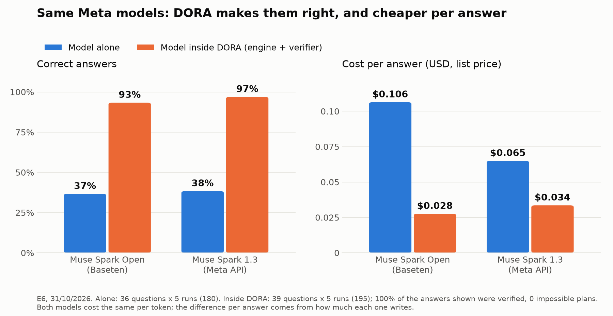
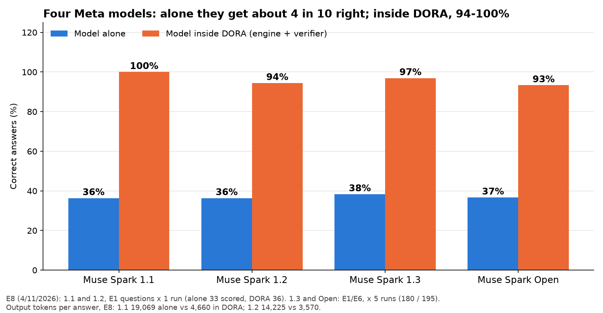

# DORA: a crop-season planning agent

Built during the Meta Global AI Developer Hackathon (build period: Oct 27 – Nov 4, 2026). Everything in this repository was written during the event; the git history starts on Oct 27.

**Prior work.** The idea builds on earlier research by the author: a paper on shadow prices of capital over a crop season and a private prototype of the optimizer. No code from that prototype was copied here; the engine, the agent, the verifier, the app and the evaluation in this repository were written from scratch during the event, as the git history shows.

**Live demo:** https://guillermosiaira--dora-web.us-east.modal.run (Spanish and English; the first load can take a minute while the container starts).

**Video (3 min):** https://youtu.be/W4zBWeavPi0

An Argentine grain farmer describes the season in plain words, a voice note, a photo of an invoice or a field drawn on the map. An agent running on Meta's Muse Spark turns that into a scenario and calls a linear-programming engine that plans the season fortnight by fortnight: how many hectares of each crop, when to sell or store, when to use credit, and what each scarce resource is worth (shadow prices of cash, capital, land, storage and credit). It also tells an owner what renting the land out would pay and the rent above which renting beats farming, and for each crop left out, the price in each sale fortnight at which it would be worth sowing (from the LP reduced costs, checked by re-solving). A deterministic verifier checks that every number in the agent's answer comes from the engine before the farmer sees it. When something the farmer did not say could change the plan, the agent asks one question at a time, starting with the one that would cost the most to get wrong.

**The language model talks; the math decides.** The model never computes a plan: it builds the scenario, calls the tools and explains the result.

## How it works

```
farmer (text, voice, photo, map)
   │  Voice Transcribe · Muse Spark vision · SAM 3.1 (water on aerial photos)
   ▼
agent (Muse Spark 1.3) ── tools ──► build_scenario · evaluate_season · shadow_prices ·
   │                                 sensitivity · compare_regions · climate_scenarios ·
   │                                 record_document · assess_field_image · next_question ·
   │                                 break_even_prices · tax_wedge · …
   │                                        │
   │                                        ▼
   │                             LP engine (HiGHS): fortnightly cash, credit, storage,
   │                             land tenure, sowing windows, climate scenarios, livestock in heads
   ▼
verifier: every number in the answer must come from a tool result → correction round if not
   ▼
answer that starts with the decision, in the farmer's language
```

- Engine, equations and the code line of each one: [`docs/model.md`](docs/model.md).
- Code map: [`docs/mapa-del-codigo.md`](docs/mapa-del-codigo.md). Specs for each step: [`docs/specs/`](docs/specs/).
- Regions: Southeast Buenos Aires (Balcarce), Pampas core (Pergamino), Iowa and Mato Grosso, each with its export routes and freight. With June-2026 margins, renting the land out pays more than sowing it in the three Argentine regions; by default DORA plans the season the farmer sows and says how much renting would pay and at what rent it would beat farming. The plan starts on the date the farmer chooses (today by default).

## Results

Every number below comes from an experiment card (the interview, from its raw output) in [`docs/experimentos/`](docs/experimentos/README.md), with its commit, command, raw output and cost. Each question has a right answer computed by the engine; "alone" means the same model answering without DORA's tools.

**Muse Spark alone vs. DORA** ([E1 complete](docs/experimentos/2026-10-30-e1-completo-muse-spark.md): 39 questions × 5 repetitions):

| | A · model alone | B · DORA without verifier | C · full DORA |
|---|---|---|---|
| Correct answers | 69 of 180 (38 %) | 186 of 195 (95 %) | 189 of 195 (97 %) |
| Same number in all 5 repetitions | 5 of 33 questions | 33 of 34 | 34 of 35 |
| Answers with an unsupported number | 154 of 180 | 23 of 195 | 19 of 195, fixed before shown (100 % verified) |
| Plans that cannot be carried out | 9 of 159 | 0 of 152 | 0 of 150 |
| Median time per answer | 76.9 s | 18.1 s | 18.5 s |

**Final run on the frozen model** ([E1 final](docs/experimentos/2026-11-01-e1-final.md), tag `model-v4-2026-11-01`, 41 questions × 3, including 5 livestock questions):

| | Full DORA |
|---|---|
| Correct answers | 121 of 123 (98.4 %) |
| Verified answers | 123 of 123 |
| Plans that cannot be carried out | 0 of 101 |
| Median time per answer | 17.8 s |
| Cost of the whole run (list price) | 5.24 USD |

The two wrong answers are Iowa scenarios the agent built wrong (it planned about 59 ha of soybean, worth about half the optimum); the card shows them.

**Other models, same harness:**

| Experiment | Model | Alone | Full DORA |
|---|---|---|---|
| [E6](docs/experimentos/2026-10-31-e6-muse-spark-open.md) | Muse Spark Open on Baseten | 66 of 180 (37 %) | 182 of 195 (93 %), 100 % verified, no impossible plan |
| [Contributor](docs/experimentos/2026-10-31-e1-contributor.md) | Muse Spark 1.3 Contributor | 67 of 180 (37 %) | 186 of 195 (95 %), 100 % verified; 1.23 USD for the three conditions |
| [Llama on Modal](docs/experimentos/2026-10-30-modal-llama-8b-arreglos.md) | Llama 3.1 8B Instruct | does not call the tools | — |



**Four generations of Muse Spark** ([E8](docs/experimentos/2026-11-04-e8-generaciones.md), 4/11; 1.1 and 1.2 with 1 repetition): alone, 1.1, 1.2, 1.3 and Open all get 36-38 % right; inside DORA, 100 %, 94 %, 97 % and 93 %, and each writes about 4 times fewer output tokens. A newer model does not solve the planning problem; the architecture does. This is a curve by generation, not by size: a curve by model size needs open models of several sizes (next steps).



Inside DORA the same models are also cheaper per answer (0.028 instead of 0.106 USD with Open, 0.034 instead of 0.065 with 1.3, at list price): alone they write long hand calculations; inside DORA the engine does the math and the model explains it. Chart: [`eval/plot_e6.py`](eval/plot_e6.py).

**Voice, invoices and photos** ([E3](docs/experimentos/2026-10-31-e3-multimodal.md)): with synthetic voice notes and drawn test images: voice notes gave the same present value as the written question 6 of 6 times; invoice amounts were read exactly 6 of 6 times, and the cost per hectare was loaded right 6 of 6 times from the photo against 2 of 6 when the farmer typed it; SAM 3.1 measured the water on the drawn aerial images within one point of the true share. Real photos are still untested.

**Robustness** ([E5](docs/experimentos/2026-10-31-e5-robustez.md), 11 trap questions × 5: missing data, out of scope, impossible scenario, pressure): with the verifier 55 of 55 pass (with the scoring rule corrected after reading the answers; 46 of 55 with the original rule) and no answer reaches the farmer with unsupported numbers; without it, 11 of 55 do.

**The interview** (SPEC-29, simulated farmer, [raw output](docs/experimentos/raw/2026-11-01_e7_interview.json)): in 4 cases the agent asked 10 questions in 14 turns, never more than one per reply, each saying what it would assume if the farmer did not know; every reply was verified, and each interview stopped by itself when nothing left could change the plan by more than 1 %.

## What is provisional
- Livestock (cow-calf, backgrounding, pasture and feedlot finishing) uses a research report with sources, but only one figure is checked against its source so far; the app marks those data as provisional.
- Mato Grosso and Pampas core data are marked provisional where they are regional estimates.
- Prices default to today's quotes and fall back to the last saved ones, with their date.

## Run it

```
python -m venv .venv
.venv/Scripts/pip install -r requirements.txt
.venv/Scripts/python -m pytest
```

Copy `.env.example` to `.env` and set `DORA_API_BASE`, `DORA_API_KEY` and `DORA_MODEL` (Meta's API: `https://api.meta.ai/v1`, `muse-spark-1.3`). Then:

- Web app: `python app.py` (http://localhost:7860).
- MCP server: `python -m mcp_server` (stdio) or `MCP_TRANSPORT=streamable-http python -m mcp_server` (HTTP).
- Terminal chat: `python chat.py`.
- Evaluation: `python eval/run_eval.py --runs 3` (add `--no-verifier` or `--baseline` for conditions B and A).
- Public deploy: `modal deploy infra/modal/serve_app.py` ([`docs/deploy.md`](docs/deploy.md)).

## MCP server (Model Context Protocol)

External agents (Claude Desktop, Claude Code, custom agronomic agents) can query DORA's optimization engine directly via MCP. Every tool response includes cryptographic provenance and mathematical verification checks (`plan_is_optimal`, `scenario_inputs`, `tenure_consistent`, `break_even_prices`).

### Local (stdio)
```bash
python -m mcp_server
```

Add to Claude Desktop (`claude_desktop_config.json`) or Claude Code:
```json
{
  "mcpServers": {
    "dora": {
      "command": "python",
      "args": ["-m", "mcp_server"],
      "cwd": "/path/to/dora"
    }
  }
}
```

### Remote (streamable HTTP)
```bash
MCP_TRANSPORT=streamable-http python -m mcp_server
```
Serves `/mcp` on `PORT` (default 8000) requiring `Authorization: Bearer <key>` configured in `DORA_MCP_KEYS="name:sha256(key),..."`, with `GET /health` publicly accessible.

## Verifiable record (EAS on Base)

DORA publishes tamper-proof records of its verified plans and seasonal outcomes using the Ethereum Attestation Service (EAS) on Base Sepolia.

### Schemas
- `dora.plan.v1`: `bytes32 recordHash, string engineVersion, bytes32 engineFingerprint, string region, uint16 season`
- `dora.outcome.v1`: `bytes32 recordHash, bytes32 planRecordHash, int32 yieldErrorBps, int32 priceErrorBps, int32 marginErrorBps, uint16 hectaresMatchBps, uint8 followedPlan`

### Explorer and Attestations
- EAS Contract (Base Sepolia predeploy): `0x4200000000000000000000000000000000000021`
- Schema Registry: `0x4200000000000000000000000000000000000020`
- Identity Registry (ERC-8004): `0x8004A818BFB912233c491871b3d84c89A494BD9e`
- Explorer: [https://base-sepolia.easscan.org](https://base-sepolia.easscan.org)

### Reputation and Track Record
To inspect public track record statistics across recorded plans and real-world outcomes:
```bash
python -m dora_chain reputation
```
This generates and refreshes `site/reputation.json` with median absolute error, percentage within ±10%, and full transparent outcome history.

## Next steps
- **Accuracy and cost by model size (E8 by size):** the same harness with open models of stepped sizes, to find the smallest model that DORA makes reliable. E8 so far covers four Muse Spark generations.
- **Weather forecast:** read the regional forecast to qualify the sowing date and the plan.
- **Mato Grosso double crop:** second-crop (safrinha) corn after soybean on the same land; today the plan treats them as separate hectares.
- **WhatsApp:** the webhook and replies are written (`dora/whatsapp.py`); the Meta business number could not be verified in time.
- **An agent one step ahead:** with the farmer's permission, connected to the tax agency (ARCA) or the mail, it learns when the accountant loads an invoice and updates the plan before the farmer asks.

## Data
Grain costs, yields and prices: the public report "Márgenes y Resultados", June 2026, from Argentina's Secretariat of Agriculture (MAGyP), plus the regional sources listed in [`docs/sources/`](docs/sources/README.md). The payment and harvest calendar is an assumption stated in `dora/scenario.py`.

## Daily data refresh (Modal)
Price curves, basis files and regional observatory reports are refreshed automatically Monday to Friday at 21:30 UTC via a scheduled job on Modal (infra/modal/refresh.py, SPEC-43). Refreshed data is stored in the dora-data Modal Volume and overlaid onto the web app and MCP containers at start without rebuilding images. engine_fingerprint() hashes dora/data/ as present on disk, ensuring plan records and cryptographic provenance deterministically reflect the exact data used for optimization.

## License
Apache License 2.0, see [`LICENSE`](LICENSE). The engine, the verifier, the agent and the evaluation set are open so anyone can check, reuse and extend them. The data in `dora/data/` come from the public sources listed above and keep their own terms.
