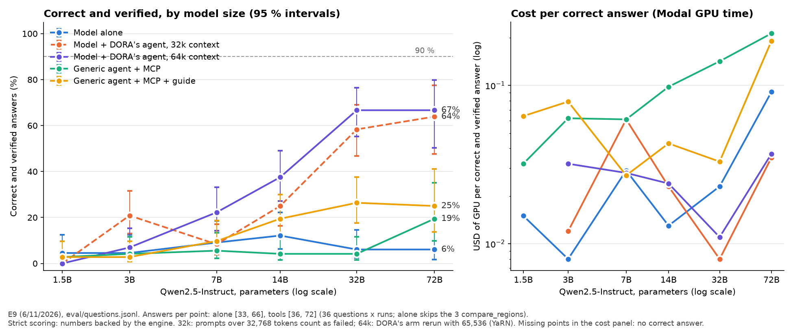

# E9: tamaño del modelo, solo y dentro de DORA (6 y 7/11/2026)

**Pregunta.** ¿Hay un tamaño mínimo de modelo a partir del cual DORA da respuestas correctas y verificadas? Por encima de ese tamaño, ¿agrandar el modelo deja de mejorar la precisión y solo sube el costo?

**Hipótesis del diseño.** Con DORA el umbral es bajo y, por encima de él, agrandar el modelo casi no cambia el error. Solo, el modelo mejora despacio y no llega.

Antecedentes: [diseño](2026-11-06-e9-diseno.md) y [piloto](2026-11-06-e9-piloto.md). Todas las respuestas, pregunta por pregunta: [2026-11-07-e9-respuestas.html](2026-11-07-e9-respuestas.html).

## Qué se corrió
- **Una sola familia: Qwen2.5-Instruct** (Alibaba), en 6 tamaños: 1,5B, 3B, 7B, 14B, 32B y 72B. Son densos: los parámetros activos son los totales. En el E9 **no** se corrieron modelos de Meta: los números de Muse Spark que se citan abajo son de E1, E6 y E8.
- **El mismo modelo en todos los brazos.** Lo que cambia entre brazos es lo que rodea al modelo:

| Brazo | Qué recibe el modelo (Qwen, en todos los casos) |
|---|---|
| **Solo** | los datos del motor en texto; responde sin herramientas (`--baseline`) |
| **DORA** | nuestro agente completo: el prompt de DORA con la guía de modelado (unos 10.000 tokens), las herramientas, el chequeo de que el escenario use solo lo que dijo el productor, y rondas de corrección si la respuesta trae números sin respaldo |
| **MCP** | un agente genérico ([`eval/mcp_agent.py`](../../eval/mcp_agent.py)): prompt neutro de 3 líneas más las 9 herramientas del motor del MCP público. Es lo que ve cualquier agente externo que se conecta a DORA |
| **MCP + guía** | lo mismo, más el texto de la guía de modelado que el MCP publica como recurso. Respecto de DORA le faltan nuestro prompt, el chequeo del escenario y las rondas de corrección |

- **Dónde:** Modal, con vLLM 0.9.2 y [`infra/modal/serve_open.py`](../../infra/modal/serve_open.py). Hasta 7B, una L40S en bf16. El 14B, una L40S en la primera pasada y una A100 de 80 GB en la de 64k. El 32B, una H100 en FP8; el 72B, dos H100 en FP8.
- **Dos pasadas del brazo DORA:**
  - **32k:** el contexto nativo de Qwen2.5, 32.768 tokens. El agente de DORA manda hasta 53.000 tokens en las preguntas largas; las que no entraron cuentan como falladas.
  - **64k:** el mismo brazo repetido con 65.536 tokens, usando la extensión YaRN que documenta Qwen. Es la medida principal de DORA.

  Los otros brazos casi no pasan los 32.768 tokens (2 cortes en total), así que se corrieron una vez, con 32k.
- **Preguntas:** las 36 de `eval/questions.jsonl`; el modelo solo responde 33, porque las 3 de `compare_regions` quedan afuera, como en E1. **2 repeticiones** de 1,5B a 32B y **1** en el 72B, por costo. Techo de 4.096 tokens por respuesta.
- **Puntaje:** "correcta y verificada", con la regla estricta del E9 ([`strict_score`](../../eval/run_eval.py)). Pide tres cosas:
  1. el número correcto está en la respuesta;
  2. el verificador no encuentra números sin respaldo;
  3. si el motor resolvió el escenario del productor, el número que devolvió es el correcto.

  Si el número correcto ya está en la pregunta (q19: "línea de 80.000"), repetirlo no cuenta. Es más exigente que la regla del E1, que con modelos chicos daba falsos aciertos (ver el piloto); la regla del E1 sigue en los resultados como `answer_correctness`.
- **Comandos:**
  - [`eval/run_e9.py`](../../eval/run_e9.py) por tamaño (ejemplo en el piloto);
  - `python eval/run_e9.py --rescore <carpeta>` para volver a puntuar;
  - `python eval/plot_e9.py` para el gráfico y el análisis;
  - `python eval/e9_page.py` para la página de respuestas.
- **Salida cruda:** `eval/results/e9/full/` (4 brazos, 32k) y `eval/results/e9/ctx64k/` (DORA, 64k).

## Resultado: aciertos

Correctas y verificadas (entre paréntesis, el porcentaje):

| Modelo | Solo | DORA, 64k | DORA, 32k | MCP | MCP + guía |
|---|---|---|---|---|---|
| 1,5B | 3/66 (5 %) | 0/72 (0 %) | 0/72 (0 %) | 2/72 (3 %) | 2/72 (3 %) |
| 3B | 3/66 (5 %) | 5/72 (7 %) | 15/72 (21 %) | 3/72 (4 %) | 2/72 (3 %) |
| 7B | 6/66 (9 %) | 16/72 (22 %) | 6/72 (8 %) | 4/72 (6 %) | 7/72 (10 %) |
| 14B | 8/66 (12 %) | 27/72 (38 %) | 18/72 (25 %) | 3/72 (4 %) | 14/72 (19 %) |
| 32B | 4/66 (6 %) | **48/72 (67 %)** | 42/72 (58 %) | 3/72 (4 %) | 19/72 (26 %) |
| 72B (×1) | 2/33 (6 %) | **24/36 (67 %)** | 23/36 (64 %) | 7/36 (19 %) | 9/36 (25 %) |

**El error es el complemento:** 100 % menos los aciertos. Con DORA (64k) el error baja de 100 % (1,5B) a 33 % (32B y 72B). Solo, se queda entre 88 y 95 % en todos los tamaños.

**Cómo cae el error con el tamaño (elasticidad).** Es el porcentaje en que baja el error cuando los parámetros suben un 1 %. Es negativa porque el error baja. Se calculó con los 6 tamaños, con intervalo del 95 %:

| Brazo | Elasticidad del error | Intervalo | Lectura |
|---|---|---|---|
| Solo | −0,01 | −0,04 a 0,02 | agrandar el modelo no cambia nada |
| DORA, 64k | **−0,32** | −0,46 a −0,18 | cada vez que el modelo se duplica, el error cae un 20 % (de su valor) |
| DORA, 32k | −0,26 | −0,44 a −0,09 | |
| MCP | −0,04 | −0,09 a 0,02 | casi plana |
| MCP + guía | −0,08 | −0,12 a −0,05 | baja poco |

**Umbral N\* (90 %):** ningún tamaño llega, en ningún brazo. El máximo es 67 %, con DORA en 32B y en 72B.

**De 32B a 72B, DORA no mejoró (67 % y 67 %), y el costo por respuesta correcta se triplicó** (0,011 a 0,037 USD). Es lo que predecía la hipótesis por encima del umbral, pero pasa en 67 % y no en 90 %. Con 1 repetición del 72B no se puede afirmar que sea una meseta: el intervalo del 72B va de 50 a 80 %.

**Llamadas a herramientas aceptadas**, de las que el modelo intentó, en DORA con 64k: 1,5B 0 %, 3B 51 %, 7B 55 %, 14B 74 %, 32B 92 % y 72B 93 %. En el MCP sin guía nunca pasa de 41 %: sin la guía, el modelo no sabe los nombres de los parámetros del escenario.

## Resultado: qué errores comete cada uno (DORA, 64k)

Cada respuesta tiene un solo tipo, en el orden en que la revisaría una persona. Las tablas de todos los brazos están en la página de respuestas.

| Tipo de respuesta | 1,5B | 3B | 7B | 14B | 32B | 72B |
|---|---|---|---|---|---|---|
| Correcta y verificada | 0 | 5 | 16 | 27 | 48 | 24 |
| No llamó ninguna herramienta | 58 | 29 | 13 | 9 | 5 | 4 |
| Llamó herramientas, todas con error | 8 | 17 | 14 | 6 | 2 | 1 |
| Armó otro escenario: el motor devolvió otro número | 0 | 13 | 20 | 21 | 12 | 3 |
| El motor tenía el número; la respuesta no lo dice | 0 | 2 | 4 | 4 | 4 | 3 |
| Número correcto, con otros números sin respaldo | 0 | 1 | 3 | 2 | 1 | 0 |
| Debía negarse o preguntar, y no lo hizo | 6 | 4 | 2 | 2 | 0 | 1 |
| Falló el pedido (otro error) | 0 | 1 | 0 | 1 | 0 | 0 |
| **Total** | 72 | 72 | 72 | 72 | 72 | 36 |

Cómo se lee:
- **Chicos (1,5B y 3B): no saben usar las herramientas.** El 1,5B escribe la llamada como texto en vez de hacerla; el 3B la hace, pero con argumentos que el motor rechaza.
- **Medianos (7B y 14B): usan las herramientas, pero arman mal el escenario.** Agregan o cambian datos: una región que el productor no dijo, una restricción de más, el capital equivocado. El motor resuelve bien un problema que no es el del productor. El verificador no los frena, porque los números sí salen del motor.
- **Grandes (32B y 72B): los errores que quedan son de otro tipo.**
  - Responden sin llamar al motor. Por ejemplo, el 72B en q01 inventó un plan de 200 ha de soja.
  - Escriben la llamada como texto (`<tool_call>…` en q26 del 72B).
  - Tienen el número del motor pero escriben otro. En q20 el motor dio 0,80 y el 72B escribió 74,7 centavos.

Ejemplos de cada caso, con el texto completo, en la [página de respuestas](2026-11-07-e9-respuestas.html).

**Tokens por respuesta:**
- solo: unos 2.100 de entrada y entre 150 y 650 de salida;
- DORA (64k): entre 58.000 y 86.000 de entrada y entre 250 y 640 de salida.

A diferencia de Muse Spark, que solo escribía unos 19.000 tokens de razonamiento, Qwen solo escribe poco: acá DORA no ahorra tokens de salida, cuesta lectura.

**Costo** (factura de Modal, `modal billing report`): piloto 1,0 USD, corrida de 4 brazos 9,0 y repetición de DORA con 64k 2,9: **12,9 USD en total** (14,1 con la repetición de los arreglos, abajo). En noviembre la cuenta de Modal lleva 13,6 de los 30 USD del mes. Costo por respuesta correcta y verificada de DORA con 64k: 7B 0,028; 14B 0,024; 32B 0,011; 72B 0,037 USD. El costo de cada brazo es una parte del tiempo de GPU encendida, repartida según el tiempo que llevó cada brazo: es una estimación.

## Qué dice sobre la hipótesis
- **"Solo, el modelo sube despacio y no llega": se sostiene, y más fuerte de lo esperado.** Solo, Qwen2.5 no mejora con el tamaño: elasticidad 0, entre 5 y 12 % de aciertos de 1,5B a 72B. Es el mismo patrón del E8, donde cuatro versiones de Muse Spark solas acertaban 36-38 %.
- **"Con DORA hay un umbral bajo": no con Qwen2.5.**
  - Ningún tamaño llega al 90 %.
  - Con DORA el error cae claramente con el tamaño hasta 32B; es el brazo donde el tamaño más importa.
  - DORA convierte la capacidad del modelo en aciertos: 67 % contra 6 % solo, con el mismo 32B.
- **"Por encima del umbral, más tamaño solo sube el costo": hay una señal, no una prueba.** De 32B a 72B la precisión con DORA no cambió (67 %) y el costo por acierto se triplicó. Hace falta más repeticiones del 72B, o un modelo más grande, para saber si es una meseta.
- **La familia pesa más que el tamaño.** Muse Spark Open, con 42B activos, llega a 93 % con DORA (E6); Qwen2.5 de 72B, a 67 %. Lo que más explica la diferencia es qué tan bien usa el modelo las herramientas y arma el escenario, y eso depende de cómo fue entrenado, no solo de los parámetros.
- **Nuestro agente aporta sobre el motor solo.** Con el mismo 32B:
  - herramientas sin instrucciones: 4 %;
  - herramientas con la guía: 26 %;
  - el agente de DORA completo: 67 %.

  El chequeo del escenario y las rondas de corrección valen tanto como la guía.

## Límites
- Una familia, de 2024; su modelo más grande es más chico y más viejo que Muse Spark. Con otra familia, por ejemplo Llama o una más nueva, los números pueden cambiar.
- 2 repeticiones, 1 en el 72B. Los intervalos son amplios: entre 32B y 72B se superponen en todos los brazos.
- El 32B y el 72B corren en FP8; los demás, en bf16.
- **YaRN cambia un poco el modelo.** Qwen avisa que estirar el contexto puede empeorar algo las respuestas cortas. El 3B acertó menos con 64k que con 32k (7 % contra 19 %), y el 7B, más (22 % contra 8 %). Con 2 repeticiones no se puede separar ese efecto del ruido.
- El agente y su prompt se ajustaron con Muse Spark. Con Qwen hay tropiezos de formato, como copiar `{value, unit, origin}` de `build_scenario` a la llamada siguiente.
- La regla del E1 que sigue adentro de la regla estricta busca el número en el texto. "16 centavos" no coincide con 0,1608, así que una respuesta correcta escrita así cuenta como error. Pasa igual en todos los brazos.

## Después: dos arreglos en DORA y su efecto (7/11)
A partir de los errores se cambiaron dos cosas (commits `e90c05b` y `26757b3`):
1. **El motor acepta el escenario "eco"** (`{value, unit, origin}`) que los modelos medianos copiaban de `build_scenario`. Toma solo lo que dijo el productor.
2. **El verificador rechaza una región que el productor no nombró.**

Se repitió el brazo DORA con 64k en 3B, 7B y 14B, con 2 repeticiones (`eval/results/e9/fixes64k/`, 1,20 USD de Modal):

| Modelo | Antes | Con los arreglos | Regiones inventadas frenadas |
|---|---|---|---|
| 3B | 5/72 (7 %) | 4/72 (6 %) | 0 |
| 7B | 16/72 (22 %) | 14/72 (19 %) | 17 |
| 14B | 27/72 (38 %) | 29/72 (40 %) | 30 |

**No cambió nada fuera del ruido.** El verificador frenó las regiones inventadas, y el modelo corrigió la llamada, pero el error dominante ("armó otro escenario") quedó igual: los modelos medianos también se equivocan en el capital, las restricciones o los plazos. Los dos arreglos son correctos y quedan, porque evitan un error real, pero no bajan el umbral. Para bajarlo hace falta otra cosa: un modelo que arme mejor el escenario (de otra familia, o entrenado para esto), o que DORA pida confirmación de los datos antes de resolver.

Con esto, el E9 costó en total 14,1 USD de Modal.

## Qué aprendimos
- **La arquitectura no reemplaza al modelo; lo amplifica.** Solo, Qwen2.5 no mejora con el tamaño. Dentro de DORA pasa de 0 a 67 %. El motor convierte la capacidad del modelo (armar el escenario, llamar bien las herramientas) en respuestas exactas, pero esa capacidad tiene que existir.
- **Cada tamaño se equivoca distinto.** Los chicos no saben usar las herramientas; los medianos las usan con el escenario equivocado; los grandes a veces las saltean. El verificador frena los números inventados, pero no los escenarios mal armados: el número sale del motor, aunque sea de otro problema. Ahí hay un arreglo para DORA: comparar el escenario con lo que dijo el productor también en las palabras, no solo en los números.
- **El umbral no es un número de parámetros.** Un modelo más nuevo y entrenado para herramientas (Muse Spark, 42B activos) llega más alto que uno más grande y viejo (Qwen2.5, 72B). Para un agente verificable, la medida que más explica el resultado es la tasa de llamadas bien hechas.
- **El contexto es parte del costo de la arquitectura.** DORA lee 30 a 40 veces más tokens que el modelo solo. Con un servidor de 32.768 tokens, eso cortó la mitad de las respuestas del 14B. Una arquitectura "más barata" tiene que medir también cuánto pide leer.
- **Medir modelos chicos obliga a afinar el evaluador.** La primera regla estricta descartaba respuestas buenas (tomaba el número de una sola herramienta) y la primera regla del E1 contaba ecos de la pregunta. Hubo que revisar respuestas a mano, en la página, para llegar a una regla justa.
- **El costo de un modelo propio es el tiempo de la GPU encendida.** El 72B costó la mitad del experimento: arranque de 5 a 15 minutos con dos H100. Conviene agrupar por tamaño y apagar cada app al terminar.
